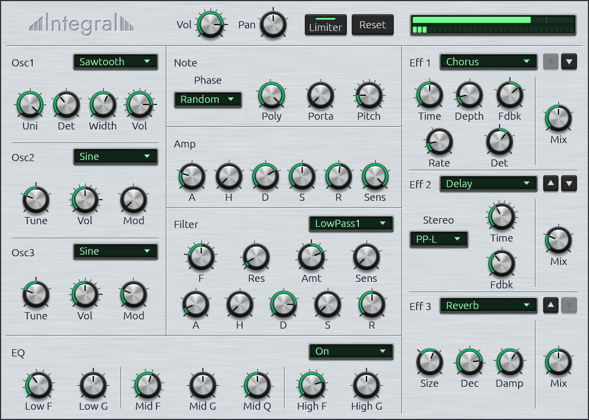

# Integral

Integralは位相変調・減算系ワークフロー・エフェクターを組み合わせたVST3ソフトウェアシンセサイザーです。

## 主な機能

- **オシレーター**：サイン波・三角波・矩形波・ノコギリ波・ホワイトノイズ。Osc1はユニゾンに対応。Osc3→Osc2→Osc1の位相変調
- **演奏表現**：最大32音のポリフォニー、モノフォニック時のポルタメント、ピッチベンド
- **音量とフィルタ**：独立したエンベロープとベロシティ感度
- **エフェクト**：コーラス、コンプレッサー、ディレイ、ディストーション、フェイザー、リバーブを3つまで自由な順序で接続
- **出力調整**：3段パラメトリックEQとリミッター

## 動作環境

| 項目 | 対応 |
| --- | --- |
| OS | x86-64 Windows / Linux (GNU) |
| CPU | AVX2・FMA3必須 |
| ホスト | VST3音源に対応したDAW |
| 音声出力 | ステレオ2ch |
| サンプルレート | 44.1 kHz以上 |

LinuxのGUIにはX11、libxkbcommon-x11、OpenGL/EGLが必要です。

## インストール

使用するOS向けのZIPを展開し、 `Integral.vst3` フォルダをVST3プラグイン用フォルダに配置してください。

## ライセンス

Copyright (C) 2026 Yusuke Oda

シンセサイザーの実装は[GNU AGPL v3.0 (AGPL-3.0-only)](LICENSE)で提供しています。
[著作権表示](COPYRIGHT)・[第三者のライセンス通知](THIRD_PARTY_NOTICES.txt)も参照してください。
出力した音の楽曲使用に制限はありません。
